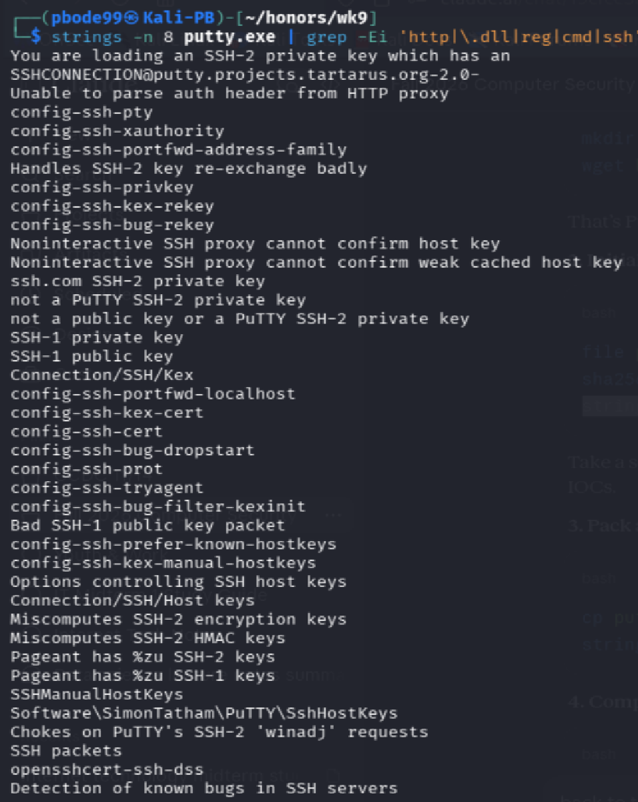
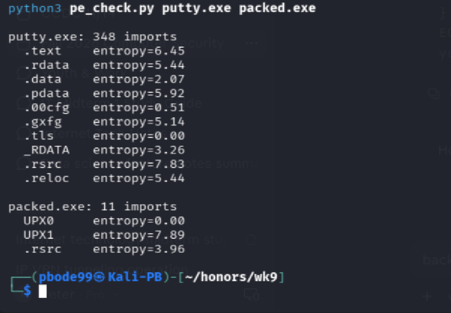
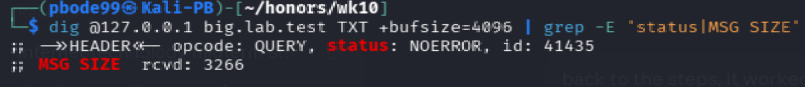
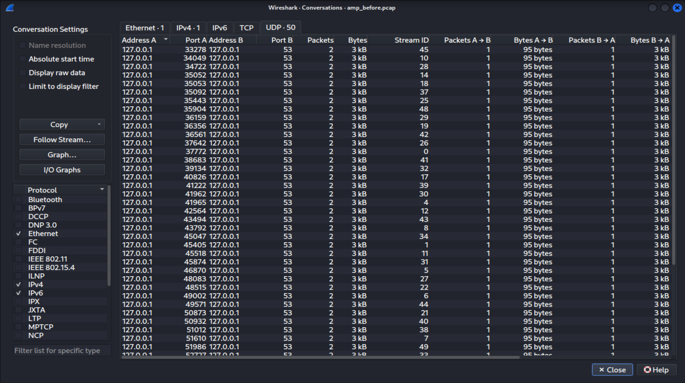
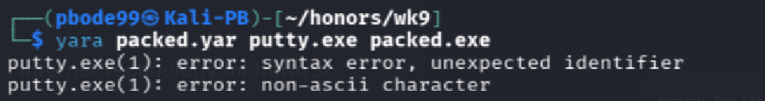
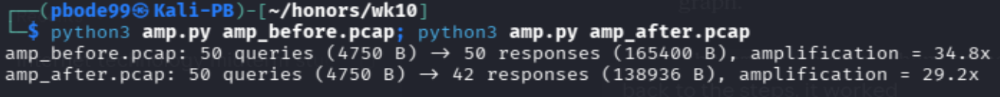
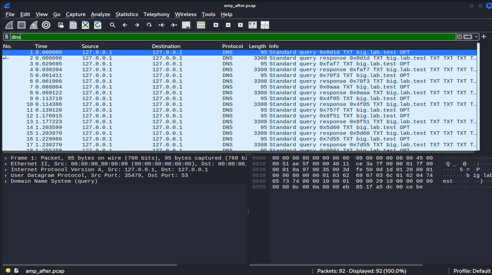

## Problem summary and threat context

This writeup covers the last two weeks of lecture, malware and its defenses followed by network security and denial of service. On the surface the two topics look unrelated. One is about a single file sitting on a disk and the other is about floods of traffic crossing a network. While working through them I found a common thread. In both cases the attacker hides how big a problem really is. A packed program looks small and harmless until it runs. A DNS query looks tiny until the answer comes back thirty times larger and lands on someone else.

I did everything on my isolated Kali VM. For the malware half I used a safe, ordinary program, the official PuTTY SSH client, and changed it myself so it would look more suspicious to an analyst. For the network half I ran my own DNS resolver on the VM and only ever sent traffic to it over the loopback interface, so no packet left the machine.

## Attacker walkthrough

### Part 1: Static triage of a Windows program

Static triage means learning what a program does without running it. I started by pulling the readable text out of putty.exe with the strings tool and filtering for anything that looked like a web address, a DLL, a registry key, or a command.



Most of the output is SSH configuration text, which is exactly what an SSH client should contain. The line I would flag as an analyst is `Software\SimonTatham\PuTTY\SshHostKeys`. That is a registry path the program writes to, so it is the kind of trace a defender could search for on a machine to tell whether this program had ever run there. These traces are called indicators of compromise, or IOCs. For a real sample this step can expose the server it talks to or the place it hides itself at startup.

Then I played the attacker. Malware authors often run their code through a packer, which compresses the program and wraps it in a small stub that unpacks the real code in memory when it runs. I packed a copy of PuTTY with UPX, a free and widely used packer, and ran the same checks on both files.


The difference was bigger than I expected. The file shrank from 1,706,136 bytes to 996,504. The readable strings dropped from 5,474 to 654, a loss of about 88 percent. The import table, which lists the Windows functions a program plans to call, fell from 350 lines to 13. For a moment I was confused when a second tool reported 348 and 11 instead. The answer turned out to be simple. The rabin2 output includes two header lines, and wc counted them along with the real imports. Either way, almost everything an analyst would normally read had disappeared.

The section listing explained where it went. The section named UPX0 has a size of zero on disk but reserves 0xc0000 bytes in memory. It is an empty space that the stub fills with the real program at run time. Both UPX sections are also marked rwx, meaning they can be written to and executed. That caught my eye because it breaks the "write or execute, never both" rule we covered in the memory corruption lectures. The packer needs that permission so it can write the unpacked code and then run it.

Next I measured entropy, which describes how random the bytes in each section look on a scale from 0 to 8. Normal code sits around 6. Compressed or encrypted data sits close to 8, because it has no patterns left to find.



The original .text section, where the code lives, came in at 6.45. After packing, UPX1 holds all of the compressed code at 7.89, and UPX0 sits at 0.00 because it is empty on disk. One detail surprised me. The original PuTTY's .rsrc section was already at 7.83. That section holds icons and other resources that are compressed to begin with. It was a good reminder that high entropy on its own does not prove anything is bad.

### Part 2: DNS amplification

A DNS amplification attack takes advantage of a simple imbalance. A DNS question is small, and some answers are very large. The attacker sends questions to a DNS server but forges the source address so it points at a victim. The server sends each large answer to the victim, so the attacker's small amount of bandwidth turns into a much larger flood that the attacker never has to send directly.

To measure this safely, I set up the Unbound DNS resolver on my VM with a made up zone called lab.test. I gave one name, big.lab.test, fifteen long text records so its answer would be large. A single test query confirmed it worked. The answer came back at 3,266 bytes.



I then captured 50 queries with tcpdump and wrote a short Scapy script that adds up the bytes sent in each direction. There was a moment of confusion here. My first attempt to stop tcpdump with `sudo kill %1` failed, because sudo runs in a new shell that cannot see my terminal's job list. The capture kept running in the background, and my first count read 49 queries instead of 50 since the last packets had not been written to the file yet. After stopping it properly with `sudo pkill tcpdump`, the numbers settled.

The result was 4,750 bytes of questions producing 165,400 bytes of answers, an amplification factor of 34.8. Wireshark's conversation view shows the same imbalance on every single exchange. Each question was 95 bytes on the wire and each answer was about 3 kB.



To put that in perspective, an attacker with 10 Mbps of upload could aim roughly 350 Mbps at a victim using a server that behaves like mine, and the victim would only ever see traffic coming from the DNS server.

## Defender's analysis

### Packing and static detection

Packing is not a coding flaw, so it does not fit a CWE. It is better described as an attacker technique, and MITRE ATT&CK tracks it as T1027.002, Software Packing. The defender's job here is detection, and this exercise turned up several signals worth checking. These include sections with entropy close to 8, an import table that is suspiciously small for a program of that size, sections that are both writable and executable, and known packer section names.

I tried to turn that last signal into a YARA rule, which is a pattern a scanner can match against files. It looks for the Windows executable header plus at least two of the UPX markers.

```
rule UPX_Packed_PE {
  strings: $a = "UPX0" $b = "UPX1" $c = "UPX!"
  condition: uint16(0) == 0x5A4D and 2 of them
}
```

My first scan failed with a syntax error, which confused me because the rule itself was fine.



The error message pointed at putty.exe, line 1. YARA only scans the last path on the command line and treats everything before it as more rule files, so it was trying to read PuTTY as a set of rules. Scanning each file separately fixed it, and the rule matched the packed copy and not the original.

The rule works, but I would not trust it alone. Section names are easy to rename, and an attacker who changed UPX0 to something ordinary would slip right past it. A stronger approach combines the structural signals above, then follows up with dynamic analysis in a sandbox, because the packed code has to unpack itself in memory eventually and that is where it can be caught. Application allowlisting helps as well, since a packed program from an unknown source simply would not be allowed to run.

### DNS amplification

The weakness here is a server that answers unlimited requests from anyone with responses much larger than the requests. That maps to CWE-406, Insufficient Control of Network Message Volume (Network Amplification). I tested one mitigation directly by turning on Unbound's per address rate limit at 5 queries per second and repeating the capture.



Responses dropped from 50 to 42, and amplification fell from 34.8 to 29.2. The packet list shows the limit working. About five questions get answered, then one goes unanswered, and the next answer arrives a full second later once the limit resets.



At first I was underwhelmed that only 8 of 50 answers were blocked. Then it clicked. My test tool sends one question at a time and waits up to a second whenever an answer does not come back, and that wait gives the limit time to reset. In other words, my test was politely slowing itself down. A real attacker does not wait, so far more of their traffic would hit the limit. Rerunning the test with all 50 queries sent at once is my next step to show that properly. I also noticed that every answer that did get through was still the full 3,308 bytes. Rate limiting caps how many answers a source can trigger, but it does nothing about the size of each one.

The most interesting lesson came from my own setup. To make the attack work at all, I had to raise Unbound's max-udp-size to 4096. By default Unbound caps answers sent over UDP at around 1,232 bytes. Anything larger gets cut short, and the client has to ask again over TCP. TCP requires a handshake with the real sender, which a forged address cannot complete. That means the default setting was quietly blocking the large answers I needed. I had essentially switched off a defense in order to build the attack.

A full defense layers several of these protections.

- Keep the UDP answer size cap so large answers move to TCP.
- Rate limit responses per source address.
- Never run an open resolver. A DNS server should only answer recursive questions from its own users.
- Apply BCP 38 source address filtering at network edges, so packets with forged source addresses never leave the network they were sent from.
- Return minimal answers to ANY queries as described in RFC 8482, since ANY was a favorite request for producing large responses.

For detection, the signals are visible in exactly what I captured. Defenders should watch for a lopsided ratio of response bytes to query bytes, many large DNS answers going to a single address that never asked for them, and repeated queries for the same large record.

## Reflection

The malware half connected to more of the course than I expected. The rwx sections tied straight back to memory protections from the memory corruption unit, and the fact that the packer's real code only exists in memory explained why the malware lecture stressed dynamic analysis and in memory scanning alongside signatures. Static triage is fast and cheap, but this exercise showed how easily one compression step can take away most of what it relies on.

The amplification half made the denial of service lecture feel concrete. Reading that amplification attacks multiply traffic is one thing. Watching 4.7 kB turn into 165 kB on my own machine is another. The part I will remember most is the UDP size cap. Some of the best defenses are quiet default settings that are easy to overlook until you have to disable one yourself.

## References

PuTTY. Download PuTTY. https://www.chiark.greenend.org.uk/~sgtatham/putty/

UPX. The Ultimate Packer for eXecutables. https://upx.github.io/

VirusTotal. YARA documentation. https://yara.readthedocs.io/

pefile. Python PE parsing module. https://github.com/erocarrera/pefile

NLnet Labs. Unbound DNS resolver. https://nlnetlabs.nl/projects/unbound/

MITRE. ATT&CK T1027.002, Obfuscated Files or Information: Software Packing. https://attack.mitre.org/

MITRE. CWE-406, Insufficient Control of Network Message Volume. https://cwe.mitre.org/
