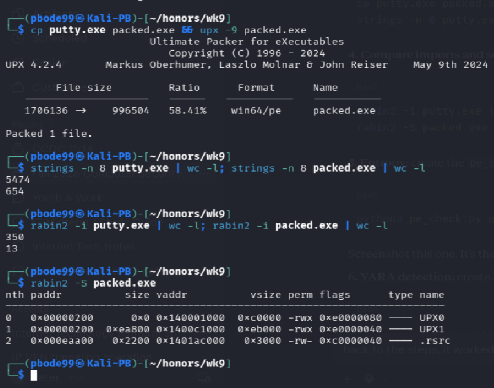

## Problem summary and threat context

This writeup covers the last two weeks of lecture, malware and its defenses followed by network security and denial of service. The two topics look unrelated at first, since one deals with a single file sitting on a disk and the other with floods of traffic crossing a network. They share a theme once you look closely, which is that the attacker works to hide how large a problem really is. A packed program looks small and harmless until it runs, and a single DNS query looks trivial until the answer returns many times larger and lands on someone who never asked for it.

I did all of this on my isolated Kali VM. For the malware half I used a safe, ordinary program, the official PuTTY SSH client, and modified it myself so that it would look more suspicious to an analyst. For the network half I ran my own DNS resolver on the VM and only ever sent traffic to it over the loopback interface, so no packet left the machine.

## Attacker walkthrough

### Part 1: Static triage of a Windows program

Static triage means learning what a program does without running it. I started by pulling the readable text out of putty.exe with the strings tool and filtering for anything that looked like a web address, a DLL, a registry key, or a command.


Most of the output is SSH configuration text, which is exactly what an SSH client should contain. The line I would flag as an analyst is `Software\SimonTatham\PuTTY\SshHostKeys`, a registry path that the program writes to. It is the kind of trace a defender can search for on a machine to tell whether this program has ever run there, and traces like it are called indicators of compromise, or IOCs. For a real sample, this step can expose the server that the malware talks to or the location it uses to launch itself at startup.

To see how an attacker hides that information, I ran the program through a packer. A packer compresses an executable and wraps it in a small stub that unpacks the real code in memory when the program runs. I packed a copy of PuTTY with UPX, a free and widely used packer, and then ran the same checks on both the original and the packed copy.



The packed copy loses almost everything an analyst would normally read. The file shrank from 1,706,136 bytes to 996,504. The readable strings dropped from 5,474 to 654, a reduction of about 88 percent. The import table, which lists the Windows functions that a program plans to call, fell from 350 entries to 13. A second tool counted 348 and 11 for the same two files, because it does not include the two header lines that the first tool printed, but both tools report the same collapse.

The section listing explains where the code went. The section named UPX0 has a size of zero on disk but reserves 0xc0000 bytes in memory, which is empty space that the stub fills with the unpacked program at run time. Both UPX sections are also marked rwx, meaning they can be written to and executed at the same time. That combination breaks the write or execute, never both rule that we covered in the memory corruption lectures, and the packer needs it so that it can write the unpacked code and then run it.

I then measured entropy, which describes how random the bytes in each section look on a scale from 0 to 8. Ordinary code sits around 6, while compressed or encrypted data sits close to 8 because it has no repeating patterns left to find.


The original .text section, where the code lives, measured 6.45. After packing, UPX1 holds all of the compressed code at 7.89, and UPX0 reads 0.00 because it is empty on disk. The original PuTTY also carried one high-entropy section before any packing, since its .rsrc section measured 7.83 and holds icons and other resources that are already compressed. High entropy on its own therefore does not prove that a file is malicious, and it has to be read alongside the other signals.

### Part 2: DNS amplification

A DNS amplification attack takes advantage of a simple imbalance, which is that a DNS question is small while some answers are very large. The attacker sends questions to a DNS server but forges the source address so that it points at a victim. The server sends each large answer to the victim, so the attacker's small amount of bandwidth turns into a much larger flood that the attacker never has to send directly.

To measure this safely, I set up the Unbound DNS resolver on my VM with a made up zone called lab.test. I gave one name, big.lab.test, fifteen long text records so that its answer would be large. A single test query confirmed the setup, returning an answer of 3,266 bytes.


I then captured 50 queries with tcpdump and wrote a short Scapy script that adds up the bytes sent in each direction. Stopping the capture took two attempts, because my first command ran under sudo in a new shell that could not see my terminal's job list, and the capture kept running until I stopped it with sudo pkill tcpdump. Once the capture was complete, the script reported 4,750 bytes of questions producing 165,400 bytes of answers, an amplification factor of 34.8. Wireshark's conversation view shows the same imbalance on every exchange, with each question at 95 bytes on the wire and each answer at about 3 kB.


To put that in perspective, an attacker with 10 Mbps of upload could aim roughly 350 Mbps at a victim using a server that behaves like mine, and the victim would only ever see traffic coming from the DNS server.

## Defender's analysis

### Packing and static detection

Packing is not a coding flaw, so it does not map to a CWE. It is better described as an attacker technique, and MITRE ATT&CK tracks it as T1027.002, Software Packing. The defender's task here is detection, and this exercise produced several signals worth checking, which include sections with entropy close to 8, an import table that is unusually small for a program of that size, sections that are both writable and executable, and known packer section names.

I turned the last signal into a YARA rule, which is a pattern that a scanner matches against files. The rule looks for the Windows executable header together with at least two of the UPX markers.

```
rule UPX_Packed_PE {
  strings: $a = "UPX0" $b = "UPX1" $c = "UPX!"
  condition: uint16(0) == 0x5A4D and 2 of them
}
```

The first scan failed with a syntax error that pointed at putty.exe rather than at the rule.


YARA only scans the last path on the command line and treats everything before it as additional rule files, so it was trying to read PuTTY as a set of rules. Scanning each file separately solved this, and the rule then matched the packed copy and not the original.

The rule works, but it is not reliable on its own. Section names are easy to rename, and an attacker who changed UPX0 to an ordinary name would pass straight through it. A stronger approach combines the structural signals above and then follows up with dynamic analysis in a sandbox, because the packed code has to unpack itself in memory eventually, and that is where it can be caught. Application allowlisting adds another layer, since a packed program from an unknown source would not be allowed to run in the first place.

### DNS amplification

The weakness here is a server that answers unlimited requests from anyone and returns responses much larger than the requests. This maps to CWE-406, Insufficient Control of Network Message Volume. I tested one mitigation directly by turning on Unbound's per address rate limit at 5 queries per second and repeating the capture.


Responses dropped from 50 to 42, and amplification fell from 34.8 to 29.2. The packet list shows the limit at work, with about five questions answered, then one left unanswered, and the next answer arriving a full second later once the limit resets.


The modest size of that drop comes from how my test client behaves rather than from a weak defense. The client sends one question at a time and waits up to a second whenever an answer does not arrive, and that wait gives the rate limit time to reset, so the test effectively throttles itself. A real attacker sends continuously and would have far more of its traffic blocked. Sending all 50 queries at once is the next test I plan to run to show this properly. Every answer that did get through was still the full 3,308 bytes, which is a reminder that rate limiting caps how many answers a source can trigger but does nothing about the size of each one.

The clearest lesson came from my own setup. To make the attack work at all, I had to raise Unbound's max-udp-size to 4096. By default Unbound caps answers sent over UDP at around 1,232 bytes, and anything larger is cut short so that the client has to ask again over TCP. TCP requires a handshake with the real sender, which a forged source address cannot complete, so the default setting was already blocking the large answers that the attack depends on. Building the attack meant switching off a defense that was working.

A full defense layers several of these protections.

- Keep the UDP answer size cap so that large answers move to TCP.
- Rate limit responses per source address.
- Never run an open resolver, since a DNS server should only answer recursive questions from its own users.
- Apply BCP 38 source address filtering at network edges, so that packets with forged source addresses never leave the network they were sent from.
- Return minimal answers to ANY queries as described in RFC 8482, since ANY was a favorite request for producing large responses.

For detection, the signals appear in exactly what I captured, which are a lopsided ratio of response bytes to query bytes, many large DNS answers going to a single address that never asked for them, and repeated queries for the same large record.

## Reflection

The malware half tied back to several earlier parts of the course. The rwx sections connect directly to the memory protections from the memory corruption unit, and the fact that the packer's real code only exists in memory explains why the malware lecture emphasized dynamic analysis and in memory scanning alongside signatures. Static triage is fast and cheap, yet this exercise showed how a single compression step removes most of what it depends on.

The amplification half made the denial of service lecture concrete. Reading that amplification attacks multiply traffic is one thing, and watching 4.7 kB turn into 165 kB on my own machine is another. The detail I will keep in mind is the UDP size cap, since some of the strongest defenses are quiet default settings that are easy to overlook until you have to disable one yourself.

## References

PuTTY. Download PuTTY. https://www.chiark.greenend.org.uk/~sgtatham/putty/

UPX. The Ultimate Packer for eXecutables. https://upx.github.io/

VirusTotal. YARA documentation. https://yara.readthedocs.io/

pefile. Python PE parsing module. https://github.com/erocarrera/pefile

NLnet Labs. Unbound DNS resolver. https://nlnetlabs.nl/projects/unbound/

MITRE. ATT&CK T1027.002, Software Packing. https://attack.mitre.org/

MITRE. CWE-406, Insufficient Control of Network Message Volume. https://cwe.mitre.org/
